  

  

<h2>🛠️ Tech Stack</h2>

  
  
  
  
  
  
  
  

---

### Hi, I'm Andrin 👋

I build things — mostly with AI as my pair programmer.

- ☕ **Minecraft plugins & mods** — Paper API and Fabric, downloads on [mods.ovitrinker.ch](https://mods.ovitrinker.ch)
- 🌐 **Websites** — including the shop for my 3D printing business: [3dvisionstore.ch](https://3dvisionstore.ch)
- 🖨️ **3D printing** — co-owner of 3DVisionStore
- 📐 Currently training as a *Konstrukteur EFZ* (mechanical design engineer)

### 🧱 Minecraft mods

| Mod | What it does | Versions |
|---|---|---|
| [**OviClicker**](https://github.com/Ovitrinker/OviClicker) | Configurable auto-clicker with AutoEat, HUD and custom keybinds | 1.21.11 · 26.1 · 26.2 · 26.3 |
| [**OviEmoji**](https://github.com/Ovitrinker/OviEmoji) | Emojis in chat and on signs, with picker and autocomplete | 1.21.11 · 26.2 · 26.3 |

Both are Fabric client mods built from a single multi-version codebase with [Stonecutter](https://stonecutter.kikugie.dev).

### 🛠️ Other projects

- [**claude-ampel**](https://github.com/Ovitrinker/claude-ampel) — always-on-top status light for every running Claude Code session (Windows)

📍 Zürich, Switzerland · 🌐 [ovitrinker.ch](https://ovitrinker.ch)
